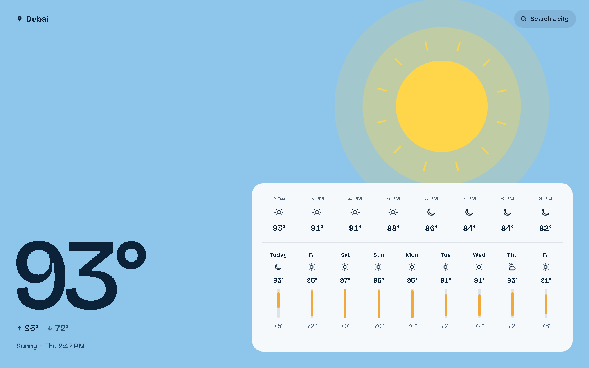
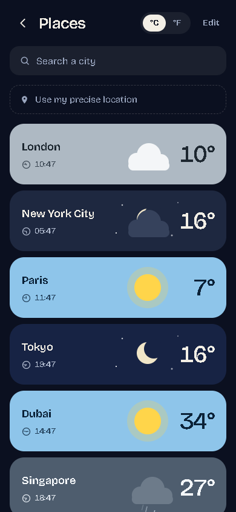
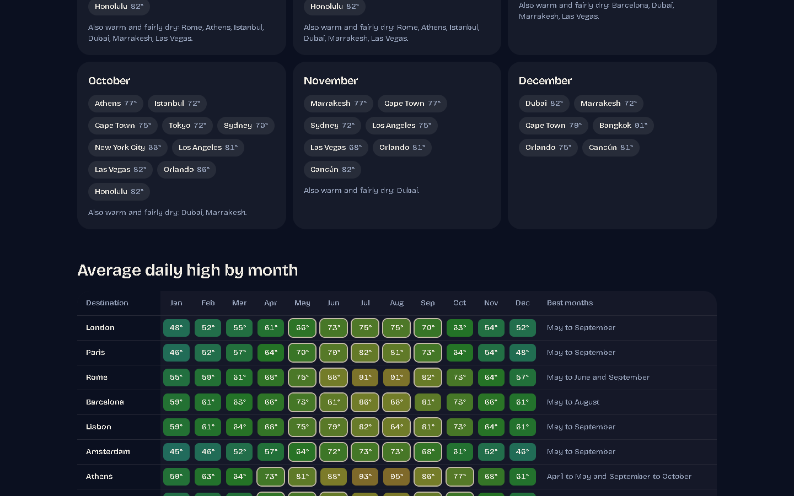

# weather.ayamk.in

Live weather for 34,000 cities with an animated sky that matches the conditions outside, an hourly and 9-day forecast, nine detail tiles, and month-by-month climate guides for 25 travel destinations.

**Live site: [weather.ayamk.in](https://weather.ayamk.in)**

| Night in Los Angeles | Day in Dubai |
| --- | --- |
|  |  |

| Saved places on a phone | Best time to visit |
| --- | --- |
|  |  |

## Features

- **Scene per condition.** Nine sky scenes (clear, cloudy, rain, storm, snow, each by day and night) drive the art and the whole colour palette, so a city at 2 AM looks like 2 AM.
- **Forecast.** Current conditions, the next 24 hours, a 9-day outlook, and tiles for rain, wind, sunrise and sunset, humidity, feels-like, UV, pressure, cloud cover and moon phase.
- **City search across 34,197 places** with more than 15,000 people. Search and nearest-city lookup run in the browser against static files, so they cost no server calls.
- **Places.** A saved list of cities with live temperature and local time, kept on the device. No account.
- **Climate guides** for 25 destinations: monthly highs, lows, rainfall and rainy days for 2015 to 2024 from weather-station records, plus best months to visit.
- **[Best time to visit](https://weather.ayamk.in/best-time-to-visit)** hub with a downloadable CSV under CC BY 4.0.
- **°C/°F and 12/24-hour time** chosen before first paint, so cached pages are right for every visitor without a flash.
- **Installable** as an app (manifest, maskable icons), with share cards that show the live temperature.

## Stack

Next.js 16 (App Router, Cache Components, partial prefetching), React 19.3 (`ViewTransition`, `Activity`), Tailwind CSS 4, TypeScript. Hosted on Vercel. No database, no API keys.

## How a request is served

| Route | What happens | Cost per visit |
| --- | --- | --- |
| `/` | `src/proxy.ts` picks a city (a saved `home` cookie, else the nearest city over 100,000 people to the visitor's IP location) and rewrites to `/home/<slug>` | One small proxy run, page from cache |
| `/weather/<slug>` | Cached page from the CDN, regenerated in the background at most every 30 minutes and only when visited | No function on a cache hit |
| `/places` | Cached page with the 12 default cities' weather built in (refreshed every 15 minutes). Saved places live in `localStorage` through one store (`src/lib/snap-store.ts`) | CDN hit; a first visit makes no weather requests |
| `/api/defaults` | All 12 default snapshots in one response, used only when the served Places page is older than its window | One function per 15 minutes |
| `/api/now/<slug>` | Small JSON for a city the visitor adds, cached at the CDN for 30 minutes. Fetched when a card is added, or ahead of time when a search result is hovered | One function per city per 30 minutes |
| City search | Prefix shards in `public/data/<version>/s/`, immutable, filtered on the device | None |
| Precise location | Geo-grid shards in `public/data/<version>/g/`, nearest city computed on the device | None |

**Forecast data.** `src/lib/met.ts` calls MET Norway with an identifying User-Agent, at most 4-decimal coordinates and a concurrency cap of 4. Server errors, network failures and truncated or stale responses are retried with backoff, falling back from the `complete` to the `compact` product and to a less precise coordinate (a fresh upstream cache entry), all inside a 15-second budget. A 429 is never retried. The mapped result, not the raw 100 KB response, is cached per city with `'use cache'` and `cacheLife`, so MET sees at most one request per city per 30 minutes whatever the traffic.

**No polling.** A tab left open refreshes once when you come back to it, and only if its data is older than 35 minutes.

**First visits.** City pages use `ensureStatic = "navigation"`: the first visit to an uncached city waits for one full render (about a second), then every visitor gets the cached page. Nobody sees a skeleton that swaps to content.

**Crawlers** get the same cached HTML as browsers (`htmlLimitedBots` in `next.config.ts`). `robots.txt` names the main search, AI and link-preview crawlers and allows them. Preview deployments serve a `robots.txt` that blocks everything.

## Motion

- Scene art is SVG compiled at build time (`scripts/build-art.mjs`). Rain and snow are CSS-animated lines.
- Entrance motion (hero rise, sheet slide-up, staggered hours, growing bars) is CSS keyframes, so it starts on first paint without waiting for JavaScript.
- Parallax uses CSS scroll timelines, with a single scroll listener as the fallback.
- Tile gauges animate once when scrolled into view, through one shared `IntersectionObserver`.
- Page changes use React `<ViewTransition>`: scenes crossfade, and a Places card's name and temperature morph into the city page.
- Each page's palette is set by `RootVars` (`src/components/root-vars.tsx`), which switches itself off while Next keeps the page hidden for back navigation.
- `prefers-reduced-motion` turns all of it off.

## Getting started

Requires Node 24.

```bash
npm install
npm run dev        # http://localhost:3000
```

No environment variables are needed to run it locally.

| Script | What it does |
| --- | --- |
| `npm run dev` | Development server |
| `npm run build` / `npm start` | Production build and server |
| `npm run check` | ESLint and TypeScript, the same checks CI runs before the build |
| `npm run data:cities -- <geonames-dir>` | Rebuilds city records and search shards from GeoNames |
| `npm run data:climate -- <ghcn-dir> [slug...]` | Rebuilds climate averages from NOAA GHCN-Daily |
| `npm run data:art -- <design-export-dir>` | Recompiles the scene SVG. Needs the original design export, which is not in this repository; the compiled art is committed |
| `npm run indexnow` | Submits the sitemap URLs to IndexNow. Run it after destination pages change, not on every deploy |

GitHub Actions (`.github/workflows/ci.yml`) runs lint, typecheck and a production build on every push to `main` and every pull request.

## Environment variables

All optional for local development. Copy `.env.example` to `.env.local` to set any of them.

| Name | Purpose |
| --- | --- |
| `NEXT_PUBLIC_SITE_URL` | Canonical origin. Defaults to `https://weather.ayamk.in` |
| `MET_USER_AGENT` | User-Agent sent to MET Norway. **Set this when you deploy.** MET's terms require one that identifies your site and a way to contact you; without it the app sends a generic development identifier |
| `NEXT_PUBLIC_CONTACT_EMAIL` | Address shown on the contact page. Hidden when unset |
| `PRERENDER_SLUGS` | Comma-separated cities to prerender at build. Defaults to `london-gb`, so a weather API outage cannot fail a deploy |
| `GOOGLE_SITE_VERIFICATION` | Search Console token (the `content` value of Google's meta tag; the whole tag also works) |
| `BING_SITE_VERIFICATION` | Bing Webmaster Tools `msvalidate.01` token |
| `ADSENSE_PUBLISHER_ID` | Serves `/ads.txt` |
| `NEXT_PUBLIC_ADS_ENABLED`, `NEXT_PUBLIC_ADSENSE_CLIENT` | Turn on the reserved ad slot. Off by default. Add the ad network's origins to the Content-Security-Policy in `next.config.ts` first |
| `SITE_URL` | Origin used by `npm run indexnow` |

## Data pipeline

The generated files are committed. Rebuild them only when the source data changes.

```bash
node scripts/build-data.mjs <geonames-dir>            # cities15000.txt, admin1CodesASCII.txt, countryInfo.txt
node scripts/build-climate.mjs <ghcn-dir> [slug...]   # ghcnd-stations.txt, ghcnd-inventory.txt
node scripts/build-art.mjs <mockup-dir>
```

`build-data` writes the slug-sharded city records (`data/city/`), the search and geo shards (`public/data/<hash>/`), the proxy's big-city list and `src/data/version.ts`. The hash in the path lets the shards be cached forever, so never edit `public/data` by hand: rerun the script and the hash changes.

Sources: GeoNames files from [download.geonames.org/export/dump](https://download.geonames.org/export/dump/), GHCN-Daily station lists from [NOAA NCEI](https://www.ncei.noaa.gov/pub/data/ghcn/daily/).

## Project structure

```
src/
  app/                 routes: city pages, home, places, best-time-to-visit, API, OG images, robots, sitemap
  components/          forecast view, places app, sky art, tiles, shared UI
  lib/                 MET client, forecast mapping, scenes and palettes, climate, cities, client store
  data/                featured destinations, default places, generated lookups
  proxy.ts             picks the home city for "/"
data/
  city/                city records sharded by slug (generated, GeoNames)
  climate/             monthly averages for the 25 destinations (generated, NOAA and NASA)
public/data/           search and geo shards (generated, GeoNames)
scripts/               data and art build scripts, IndexNow submit
assets/fonts/          Bricolage Grotesque for share cards, with its licence
docs/                  design decisions, data licences, screenshots
.github/workflows/     CI: lint, typecheck, build
```

## Deploying

The repository is connected to a Vercel project. A push to `main` deploys production; any other branch or pull request gets a preview URL that search engines are told not to crawl.

To run your own copy, import the repository into Vercel, set `NEXT_PUBLIC_SITE_URL` to your domain and `MET_USER_AGENT` to something like `yoursite.example https://yoursite.example/contact`, and deploy. Nothing else is required.

Every response carries security headers (`nosniff`, a strict referrer policy, a permissions policy that only allows geolocation, `X-Frame-Options: DENY`), plus a Content-Security-Policy in production. All of them are set in `next.config.ts`.

## Data and credits

- Forecasts: [MET Norway](https://api.met.no/) Locationforecast 2.0, under [CC BY 4.0](https://creativecommons.org/licenses/by/4.0/) and NLOD 2.0. Reformatted; MET Norway does not endorse this site.
- Cities: [GeoNames](https://www.geonames.org/) cities15000, under [CC BY 4.0](https://creativecommons.org/licenses/by/4.0/). The files in `data/city/`, `public/data/` and `src/data/big-cities.json` are derived from it.
- Climate: [NOAA GHCN-Daily](https://www.ncei.noaa.gov/products/land-based-station/global-historical-climatology-network-daily) (public domain) and, where no station qualified, the [NASA POWER](https://power.larc.nasa.gov/) project. Each destination page names its source and station.
- Font: [Bricolage Grotesque](https://github.com/ateliertriay/bricolage), SIL Open Font License 1.1 (`assets/fonts/OFL.txt`).
- Sun and moon times: [suncalc](https://github.com/mourner/suncalc), BSD 2-Clause.

Terms, re-check dates and per-source notes are in [docs/data-licences.md](docs/data-licences.md). Design and architecture decisions are logged in [docs/decisions.md](docs/decisions.md).

## Licence

The source code is under the [MIT License](LICENSE). The data and font listed above keep their own licences: the files derived from GeoNames, NOAA and NASA, and the Bricolage Grotesque font, are not covered by MIT.
